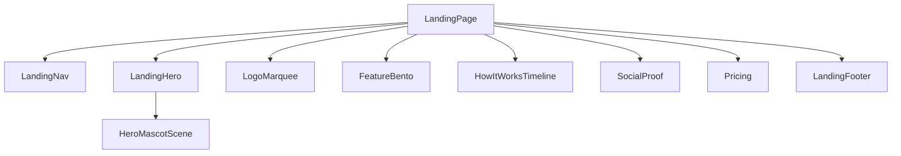

# Tyller Finance — Landing Page

Esta pasta contém o componente principal e a infraestrutura da **Landing Page (Página de Destino)** do Tyller Finance. A página foi desenhada para encantar o usuário à primeira vista, aliando uma estética futurista de alta qualidade (*glassmorphism*, gradientes vibrantes e *glow orbs*) com excelente usabilidade, acessibilidade e micro-interações responsivas.

---

## 🗺️ Visão Geral & Objetivo

O principal valor da Landing Page é apresentar a proposta central do **Tyller Finance**:
> **"Saber exatamente quanto vai sobrar no fim do mês — e o que fazer para melhorar."**

A interface demonstra visualmente como o assistente proativo de IA funciona (importação de extratos via PDF/OFX, alertas de assinaturas e projeções dinâmicas), encorajando o cadastro através de chamadas para ação (CTAs) em locais estratégicos.

---

## 🧱 Arquitetura de Componentes

A página é montada no arquivo principal [`LandingPage.tsx`](file:///c:/Users/jrica/gsd-workspaces/tyller-finance/front/src/pages/landing/LandingPage.tsx) e composta de forma modular pelas seguintes seções localizadas em [`front/src/components/landing`](file:///c:/Users/jrica/gsd-workspaces/tyller-finance/front/src/components/landing):

### 1. `LandingNav`
* **Função:** Barra de navegação fixa (sticky) responsiva.
* **Componentes:** Links âncora de scroll suave (`#features`, `#how-it-works`, `#pricing`) e CTA principal redirecionando para a rota de autenticação (`#/auth`).

### 2. `LandingHero`
* **Função:** A primeira dobra de grande impacto visual (Hero Section).
* **Funcionalidades Premium:**
  * **Typing Loop:** Efeito de digitação dinâmico que alterna entre o que a IA antecipa: *gastos*, *futuro*, *orçamento* e *saldo*.
  * **Mascote 3D (`HeroMascotScene`):** Elemento central com moedas flutuantes que orbitam tridimensionalmente.
  * **Interactive Floating Cards:** Dois cartões com efeito de vidro (*GlassCard*) que flutuam ao redor do mascote:
    * Cartão de "Sobra projetada" com sparkline (gráfico vetorial) animada via SVG path drawing.
    * Cartão de "IA Proativa" exibindo a contagem de alertas ativos com um ping pulssante de aviso.
  * **Efeito de Fundo (Glow):** Orb de luz esmeralda (`bg-glow-lime`) com forte desfoque (blur) posicionado atrás do título.

### 3. `LogoMarquee`
* **Função:** Painel infinito horizontal deslizante que exibe logotipos de marcas ou integrações técnicas parceiras para validação de autoridade.

### 4. `FeatureBento`
* **Função:** Grade no estilo *Bento Grid* exibindo os diferenciais tecnológicos da ferramenta.
* **Seções Internas:**
  * **Destaque (Feature 01) - IA Proativa:** Cartão expandido com uma pré-visualização interativa de notificação da IA (ex: detector de cobrança de Netflix duplicada).
  * **Grid Secundário:** Detalhes sobre importação instantânea (PDF/OFX), alertas em tempo real via WhatsApp, definição de metas de orçamento e projeção inteligente de saldo futuro.

### 5. `HowItWorksTimeline`
* **Função:** Linha do tempo interativa e autoexplicativa ilustrando a jornada do usuário em 3 passos estruturados:
  1. **ENTRADA:** Sincronização ou upload de extrato.
  2. **ANÁLISE:** Mapeamento inteligente invisível de hábitos pela IA.
  3. **RESULTADO:** Exibição da previsão de saldo e tomada de decisões com planos estratégicos de economia.

### 6. `SocialProof`
* **Função:** Seção de validação de confiança, operando sobre um fundo claro contrastante com textura geométrica elegante de moedas.
* **Componentes:** Cards de depoimentos com citações dos usuários em abas e grades responsivas, com estatísticas chave (ex: 12k+ transações analisadas, R$ 2.1M em projeções).

### 7. `Pricing`
* **Função:** Exibição clara e premium da precificação do Tyller Finance.
* **Componentes:**
  * Toggle interativo de período de faturamento (Mensal vs. Anual), contendo um badge de 17% de desconto na cobrança anual com transições de fade controladas.
  * Cartões de Planos (*Free*, *Pro*, *Enterprise*), destacando o plano **Pro** como a opção recomendada com efeitos de brilho em pulso.

### 8. `LandingFooter`
* **Função:** Rodapé unificado contendo links corporativos, de suporte e conformidade legal, além de um indicador visual de "Todos os sistemas operacionais".

---

## 🎨 Design System & Estética (Visual Excellence)

Toda a interface consome os tokens localizados em [`tokens.ts`](file:///c:/Users/jrica/gsd-workspaces/tyller-finance/front/src/tokens.ts) e a folha de estilos global [`index.css`](file:///c:/Users/jrica/gsd-workspaces/tyller-finance/front/src/index.css):

* **Color Palette (HSL Tailored):**
  * Predomínio de fundo escuro premium (`--color-neutral-950` - `#0a0c09`) com detalhes em verde-limão vibrante (`--color-brand-400` - `#bef030`).
  * Degradês suaves nos textos principais e badges dourados para elementos exclusivos.
* **Glassmorphism:** Uso intensivo do componente `GlassCard`, que aplica filtros de desfoque de fundo (`backdrop-filter: blur(12px)`) e bordas semitransparentes para simular vidro fosco.
* **Tipografia:** Fonte mono-espaçada `JetBrains Mono` combinada com fontes corporativas modernas sem serifa carregadas via Google Fonts.

---

## 🎬 Animações & Acessibilidade (Motion Strategy)

As animações utilizam o ecossistema `framer-motion` com os comportamentos predefinidos em [`motion.ts`](file:///c:/Users/jrica/gsd-workspaces/tyller-finance/front/src/components/landing/motion.ts):

### Micro-interações
* **Hover Micro-Scales:** Botões e cartões reagem ao ponteiro do mouse crescendo sutilmente (`scale: 1.02` ou `1.03`) e deslocando-se levemente para cima (`y: -2px` ou `-4px`).
* **Tap Reactions:** Feedback tátil instantâneo ao clicar em botões, encolhendo-os sutilmente (`scale: 0.97`).

### Acessibilidade de Movimento (`Reduced Motion`)
A página implementa suporte estrito à acessibilidade. Através do hook `useReducedMotion()`, todas as animações intrusivas são atenuadas ou desabilitadas caso o usuário possua a preferência ativada no sistema operacional:
* Animações tridimensionais de rotação de moedas no Mascot Scene são pausadas.
* Deslocamentos amplos de fade-up são convertidos para fades simples sem alteração de posição espacial (`y`).
* Efeitos de escala exagerada são mitigados para evitar fadiga visual.

### SEO e Semântica HTML
* **Tags Estruturais:** Utilização rigorosa de elementos HTML5 (`header`, `main`, `section`, `article`, `footer`, `blockquote`, `ol`, `li`).
* **Acessibilidade:**
  * Uso de atributos `aria-labelledby` ligando seções a seus respectivos cabeçalhos.
  * Links interativos e botões possuem semântica correta com suporte nativo a navegação por teclado (`tabIndex`, manipuladores `onKeyDown` para `Enter` e `Spacebar`).
  * Textos alternativos descritivos e badges com atributo `aria-hidden` para elementos puramente decorativos.

---

## 🛠️ Integração & Roteamento

A Landing Page está integrada ao roteador customizado baseado em hash (`window.location.hash`) configurado no [`App.tsx`](file:///c:/Users/jrica/gsd-workspaces/tyller-finance/front/src/App.tsx):

* **Rota Padrão:** Mapeia para `#/` ou vazio, renderizando a `<LandingPage />`.
* **Redirecionamento:** Ações de início de teste ou cliques em planos redirecionam o histórico de navegação para `#/auth`, abrindo a tela de cadastro e login.
